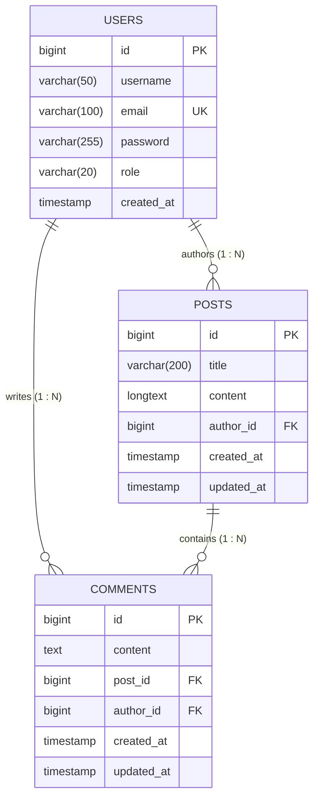
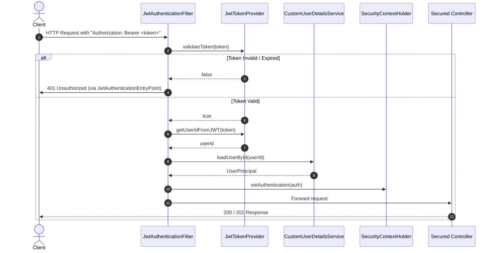

# 🚀 RESTful Blog Application API

[](https://www.oracle.com/java/)
[](https://spring.io/projects/spring-boot)
[](https://spring.io/projects/spring-security)
[](https://github.com/jwtk/jjwt)
[](https://www.mysql.com/)
[](http://localhost:8080/swagger-ui.html)
[](LICENSE)

An industry-standard, production-ready **RESTful Blog Application API** engineered with **Java 21**, **Spring Boot 3**, **Spring Security 6**, **JSON Web Tokens (JWT)**, **Spring Data JPA / Hibernate**, and **MySQL 8**. 

Architected with strict adherence to **SOLID principles**, **Separation of Concerns**, **Layered Architecture**, and modern software engineering practices. Designed specifically as a premier showcase project for a **Fresher Java Full Stack / Backend Developer Portfolio**.

---

## 📑 Table of Contents
1. [Core Features](#-core-features)
2. [Technology Stack](#-technology-stack)
3. [Architecture & Project Structure](#-architecture--project-structure)
4. [Database Design & ER Diagram](#-database-design--er-diagram)
5. [API Endpoint Reference](#-api-endpoint-reference)
6. [Security & Authentication Architecture](#-security--authentication-architecture)
7. [Installation & Getting Started](#-installation--getting-started)
8. [Running the Application](#-running-the-application)
9. [Interactive API Documentation (Swagger / OpenAPI)](#-interactive-api-documentation-swagger--openapi)
10. [Postman Collection & Automated Testing](#-postman-collection--automated-testing)
11. [Unit & Integration Testing Suite](#-unit--integration-testing-suite)
12. [Coding Standards & Portfolio Highlights](#-coding-standards--portfolio-highlights)
13. [Future Roadmap](#-future-roadmap)
14. [GitHub Submission Checklist](#-github-submission-checklist)

---

## 🌟 Core Features

- **Robust User Authentication & Authorization**:
  - Secure account registration with input validation.
  - BCrypt password hashing (never stored or exposed in plaintext).
  - Stateless authentication with signed JWT tokens (HMAC-SHA256).
  - Role-based authorization (`ROLE_USER`, `ROLE_ADMIN`).
- **Blog Post Management**:
  - Public read-only access for viewing all published posts or single post details.
  - Authenticated post creation.
  - Server-side pagination, dynamic sorting (by creation date, title, ID, etc.), and title keyword search.
  - Strict ownership validation (only original authors or administrators may edit or delete a post).
- **Interactive Comment System**:
  - Authenticated comment submission on any published blog post.
  - Public retrieval of comments filtered by post ID.
  - Strict ownership validation for updating and deleting comments.
- **Enterprise Error & Exception Handling**:
  - Centralized `@RestControllerAdvice` handling custom exceptions (`400`, `401`, `403`, `404`, `409`, `500`).
  - Standardized JSON error response payload (`ErrorResponse`) containing timestamp, HTTP status, message, path, and detailed validation maps.
- **Interactive API Documentation**:
  - Embedded **Springdoc OpenAPI 3 / Swagger UI** with Bearer Token authorization support.

---

## 🛠 Technology Stack

| Layer | Technology | Details / Version |
|---|---|---|
| **Language** | Java 21 LTS | Pattern matching, records, virtual-thread compatibility |
| **Framework** | Spring Boot | 3.3.5 (Latest stable Spring Framework 6.1) |
| **Security** | Spring Security 6 | Modern `SecurityFilterChain`, stateless `SessionCreationPolicy` |
| **Authentication** | JJWT | 0.12.6 (`jjwt-api`, `jjwt-impl`, `jjwt-jackson`) |
| **Persistence** | Spring Data JPA / Hibernate | Hibernate 6.5, Declarative `@Transactional` |
| **Database** | MySQL 8 / H2 | MySQL 8 in production/staging; in-memory H2 for isolated testing |
| **Validation** | Jakarta Bean Validation | `@Valid`, `@NotBlank`, `@Email`, `@Size` |
| **Documentation** | Springdoc OpenAPI | 2.6.0 with Swagger UI (`/swagger-ui.html`) |
| **Build Tool** | Apache Maven | Maven 3.9+ |
| **Testing** | JUnit 5, Mockito, MockMvc | 44 comprehensive unit and web integration tests |
| **Utility** | Project Lombok | Boilerplate elimination with manual fallback accessors |

---

## 🏗 Architecture & Project Structure

The codebase strictly follows a clean **Layered Architecture**:

```
com.blog
|
|-- config                  # Infrastructure configurations (OpenAPI / Swagger UI)
|   |-- OpenApiConfig.java
|
|-- controller              # REST API Controllers (No business logic; request orchestration)
|   |-- AuthController.java
|   |-- PostController.java
|   |-- CommentController.java
|
|-- service                 # Service Interfaces (Business contracts)
|   |-- AuthService.java
|   |-- PostService.java
|   |-- CommentService.java
|   |-- impl                # Service Implementations (Core business logic, transaction boundaries)
|       |-- AuthServiceImpl.java
|       |-- PostServiceImpl.java
|       |-- CommentServiceImpl.java
|
|-- repository              # Spring Data JPA Repositories (Data access layer)
|   |-- UserRepository.java
|   |-- PostRepository.java
|   |-- CommentRepository.java
|
|-- entity                  # JPA Entities (Database table mappings)
|   |-- Role.java           # Security Role Enum (ROLE_USER, ROLE_ADMIN)
|   |-- User.java
|   |-- Post.java
|   |-- Comment.java
|
|-- dto                     # Data Transfer Objects (Strict boundary protection)
|   |-- request             # Incoming payload schemas with Jakarta Validation
|   |   |-- RegisterRequest.java
|   |   |-- LoginRequest.java
|   |   |-- PostRequest.java
|   |   |-- CommentRequest.java
|   |-- response            # Outgoing safe payloads (No passwords exposed)
|       |-- AuthResponse.java
|       |-- UserSummaryResponse.java
|       |-- PostResponse.java
|       |-- CommentResponse.java
|       |-- PagedResponse.java
|       |-- ApiResponse.java
|       |-- ErrorResponse.java
|
|-- security                # Security filters, JWT providers, and UserDetails
|   |-- CustomUserDetailsService.java
|   |-- UserPrincipal.java
|   |-- JwtTokenProvider.java
|   |-- JwtAuthenticationFilter.java
|   |-- JwtAuthenticationEntryPoint.java
|   |-- SecurityConfig.java
|
|-- exception               # Custom exceptions and GlobalExceptionHandler
|   |-- ResourceNotFoundException.java      # 404 Not Found
|   |-- EmailAlreadyExistsException.java    # 409 Conflict
|   |-- UnauthorizedException.java          # 401 Unauthorized
|   |-- BadRequestException.java            # 400 Bad Request
|   |-- GlobalExceptionHandler.java         # @RestControllerAdvice
|
|-- mapper                  # Explicit Entity-to-DTO Mappers
|   |-- UserMapper.java
|   |-- PostMapper.java
|   |-- CommentMapper.java
|
|-- BlogApplication.java    # Spring Boot Main Class
```

---

## 🗄 Database Design & ER Diagram

### Entity-Relationship Diagram (ERD)



### Table Specifications

1. **`users`**:
   - `id`: `BIGINT AUTO_INCREMENT PRIMARY KEY`
   - `username`: `VARCHAR(50) NOT NULL`
   - `email`: `VARCHAR(100) NOT NULL UNIQUE`
   - `password`: `VARCHAR(255) NOT NULL` (BCrypt hash)
   - `role`: `VARCHAR(20) NOT NULL DEFAULT 'ROLE_USER'` (`ROLE_USER`, `ROLE_ADMIN`)
   - `created_at`: `TIMESTAMP DEFAULT CURRENT_TIMESTAMP NOT NULL`
2. **`posts`**:
   - `id`: `BIGINT AUTO_INCREMENT PRIMARY KEY`
   - `title`: `VARCHAR(200) NOT NULL`
   - `content`: `LONGTEXT NOT NULL`
   - `author_id`: `BIGINT NOT NULL REFERENCES users(id) ON DELETE CASCADE`
   - `created_at`: `TIMESTAMP DEFAULT CURRENT_TIMESTAMP NOT NULL`
   - `updated_at`: `TIMESTAMP DEFAULT CURRENT_TIMESTAMP ON UPDATE CURRENT_TIMESTAMP NOT NULL`
3. **`comments`**:
   - `id`: `BIGINT AUTO_INCREMENT PRIMARY KEY`
   - `content`: `TEXT NOT NULL`
   - `post_id`: `BIGINT NOT NULL REFERENCES posts(id) ON DELETE CASCADE`
   - `author_id`: `BIGINT NOT NULL REFERENCES users(id) ON DELETE CASCADE`
   - `created_at`: `TIMESTAMP DEFAULT CURRENT_TIMESTAMP NOT NULL`
   - `updated_at`: `TIMESTAMP DEFAULT CURRENT_TIMESTAMP ON UPDATE CURRENT_TIMESTAMP NOT NULL`

---

## 📡 API Endpoint Reference

### 1. Authentication Endpoints (`/api/auth`)

| Method | Endpoint | Access | Description | Status Codes |
|---|---|---|---|---|
| `POST` | `/api/auth/register` | Public | Register new user account & return JWT | `201 Created`, `400 Bad Request`, `409 Conflict` |
| `POST` | `/api/auth/login` | Public | Authenticate credentials & return JWT | `200 OK`, `400 Bad Request`, `401 Unauthorized` |
| `GET` | `/api/auth/me` | Authenticated | Fetch current authenticated user profile | `200 OK`, `401 Unauthorized` |

#### Sample Request (`POST /api/auth/register`):
```json
{
  "username": "sushil",
  "email": "sushil@example.com",
  "password": "Password@123"
}
```

#### Sample Response (`201 Created`):
```json
{
  "message": "User registered successfully",
  "token": "eyJhbGciOiJIUzUxMiJ9...",
  "tokenType": "Bearer",
  "user": {
    "id": 1,
    "username": "sushil",
    "email": "sushil@example.com",
    "role": "ROLE_USER",
    "createdAt": "2026-11-05T12:00:00"
  }
}
```

---

### 2. Post Endpoints (`/api/posts`)

| Method | Endpoint | Access | Description | Status Codes |
|---|---|---|---|---|
| `GET` | `/api/posts` | Public | List posts with pagination, sorting, search | `200 OK`, `400 Bad Request` |
| `GET` | `/api/posts/{id}` | Public | Retrieve single post by ID | `200 OK`, `404 Not Found` |
| `POST` | `/api/posts` | Authenticated | Create a new blog post | `201 Created`, `400 Bad Request`, `401 Unauthorized` |
| `PUT` | `/api/posts/{id}` | Owner / Admin | Update existing post | `200 OK`, `400`, `401`, `403 Forbidden`, `404` |
| `DELETE` | `/api/posts/{id}` | Owner / Admin | Delete post and associated comments | `200 OK`, `401`, `403 Forbidden`, `404` |

#### Query Parameters for `GET /api/posts`:
- `page`: Page index (default `0`)
- `size`: Items per page (default `10`, maximum `100`)
- `sortBy`: Field name to sort by (default `createdAt`, supports `title`, `id`, `updatedAt`)
- `sortDir`: Sort direction (default `desc`, supports `asc`)
- `title`: Optional substring search filter on post titles

---

### 3. Comment Endpoints (`/api/posts/{postId}/comments` & `/api/comments/{id}`)

| Method | Endpoint | Access | Description | Status Codes |
|---|---|---|---|---|
| `GET` | `/api/posts/{postId}/comments` | Public | Get all comments for a post | `200 OK`, `404 Not Found` |
| `GET` | `/api/comments/{id}` | Public | Get single comment by ID | `200 OK`, `404 Not Found` |
| `POST` | `/api/posts/{postId}/comments` | Authenticated | Post a comment on a blog post | `201 Created`, `400`, `401`, `404` |
| `PUT` | `/api/comments/{id}` | Owner / Admin | Update existing comment content | `200 OK`, `400`, `401`, `403 Forbidden`, `404` |
| `DELETE` | `/api/comments/{id}` | Owner / Admin | Delete comment | `200 OK`, `401`, `403 Forbidden`, `404` |

---

## 🔒 Security & Authentication Architecture



### Key Security Decisions:
1. **Stateless Session Management**: No server-side HTTP sessions (`SessionCreationPolicy.STATELESS`), allowing the API to scale horizontally across containers.
2. **Never Exposing Passwords**: The `User` password is encrypted with `BCryptPasswordEncoder`. Response DTOs (`UserSummaryResponse`) intentionally exclude password fields.
3. **Ownership Verification**: Services inspect the authenticated `UserPrincipal` and verify that `post.getAuthor().getId().equals(currentUser.getId()) || currentUser.getRole() == Role.ROLE_ADMIN` before modifying any post or comment. Unauthorized edits return `403 Forbidden`.
4. **Environment Variables**: JWT secret keys and database credentials are read from environment variables with safe development fallbacks, eliminating the risk of accidental secret leaks in version control.

---

## ⚙️ Installation & Getting Started

### Prerequisites
- **JDK 21** (Java Development Kit 21 or higher)
- **Apache Maven 3.8+**
- **MySQL 8.0+** (Optional: the project also includes a standalone dev profile with an in-memory database)

### Clone the Repository
```bash
git clone https://github.com/your-username/blog-application-api.git
cd blog-application-api
```

### Database Configuration (MySQL 8)
1. Start your local MySQL service.
2. Run the provided SQL initialization script:
```bash
mysql -u root -p < schema.sql
```
*(Optional) Seed sample data:*
```bash
mysql -u root -p < data.sql
```

### Configure Environment Variables
Copy `application.properties.example` to `application.properties` or set your environment variables:
```bash
# Optional: Set custom environment variables
export DB_HOST=localhost
export DB_PORT=3306
export DB_NAME=blog_application
export DB_USERNAME=root
export DB_PASSWORD=your_password
export JWT_SECRET=404E635266556A586E3272357538782F413F4428472B4B6250645367566B5970
export JWT_EXPIRATION_MS=86400000
```

---

## 🚀 Running the Application

### Option A: Standard Production Mode (MySQL 8)
```bash
# Build the project
mvn clean package

# Run the packaged JAR
java -jar target/blog-application-api-1.0.0.jar
```
Or with Maven Spring Boot plugin:
```bash
mvn spring-boot:run
```

### Option B: Standalone Development / Demo Mode (No MySQL Required)
If you want to immediately evaluate or showcase the API without installing or configuring a local MySQL instance, use the built-in `dev` profile (uses embedded H2 configured in MySQL compatibility mode):
```bash
java -jar target/blog-application-api-1.0.0.jar --spring.profiles.active=dev
```
*Note: In `dev` profile, the H2 Web Console is available at `http://localhost:8080/h2-console` (JDBC URL: `jdbc:h2:mem:blog_application`, User: `sa`, Password: empty).*

---

## 📖 Interactive API Documentation (Swagger / OpenAPI)

Once the application is running, access the interactive Swagger UI documentation:

📍 **Swagger UI URL:** [http://localhost:8080/swagger-ui.html](http://localhost:8080/swagger-ui.html)  
📍 **OpenAPI JSON Spec:** [http://localhost:8080/v3/api-docs](http://localhost:8080/v3/api-docs)

### How to Authenticate in Swagger UI:
1. Open [http://localhost:8080/swagger-ui.html](http://localhost:8080/swagger-ui.html).
2. Execute `POST /api/auth/register` or `POST /api/auth/login`.
3. Copy the returned `token` value.
4. Click the green **Authorize 🔓** button in the top-right corner.
5. Paste your token (no need to manually type `Bearer `, Swagger formats it automatically).
6. Click **Authorize** and then **Close**. All secured endpoints are now unlocked for testing!

---

## 📬 Postman Collection & Automated Testing

A complete Postman collection is included in the project under:
📁 `postman/Blog_Application_API.postman_collection.json`

### Features of the Postman Collection:
- **Collection-Level Bearer Token Variable**: Includes preconfigured `{{jwt_token}}`, `{{baseUrl}}`, `{{postId}}`, and `{{commentId}}` variables.
- **Automated Token Capture**: The test scripts on `Register` and `Login` automatically save the JWT token to the collection variable. Subsequent requests automatically inherit this token!
- **Complete Test Scenarios**: Includes all endpoints with pre-populated sample requests, expected responses, and validation tests.

### How to Import:
1. Open Postman.
2. Click **Import** (top left).
3. Select `postman/Blog_Application_API.postman_collection.json`.
4. Ensure your server is running on `http://localhost:8080`.
5. Send `1. Authentication -> Register New User` or `Login User` first, then run any Post or Comment request!

---

## 🧪 Unit & Integration Testing Suite

The project includes **44 automated tests** covering security, service business logic, DTO mapping, and MockMvc HTTP controllers.

### Execute All Tests:
```bash
mvn clean test
```

### Test Coverage Highlights:
- **`JwtTokenProviderTest`**: Token creation, signing key integrity, expiration handling, signature tampering rejection, subject extraction.
- **`AuthServiceTest`**: User registration, duplicate email rejection (`409 Conflict`), duplicate username validation (`400 Bad Request`), login credential verification, bad password rejection.
- **`PostServiceTest`**: Post creation, pagination & sorting logic, search filtering, post retrieval, author update success, non-author update denial (`403 Forbidden`), admin override permissions.
- **`CommentServiceTest`**: Comment publishing, comment listing per post, ownership verification for comment updates and deletions (`403 Forbidden`), admin deletion rights.
- **`AuthControllerTest` (MockMvc)**: HTTP `POST /api/auth/register` (201 Created), validation errors map (`400 Bad Request`), HTTP `POST /api/auth/login` (200 OK & 401 Unauthorized).
- **`PostControllerTest` (MockMvc)**: Public `GET /api/posts` (200 OK), unauthenticated mutation rejection (401 Unauthorized), authenticated creation (201 Created), ownership failure handling (403 Forbidden).
- **`CommentControllerTest` (MockMvc)**: Public `GET /api/posts/{postId}/comments` (200 OK), secured comment creation, ownership validation.

---

## 💎 Coding Standards & Portfolio Highlights

For senior software engineers and recruiters reviewing this codebase, note the following architectural choices:

1. **Constructor-Based Dependency Injection**:
   - Zero field injection (`@Autowired` on private fields is completely avoided). All dependencies are injected via explicit constructors, facilitating deterministic unit testing and immutability.
2. **DTO Isolation**:
   - Database entities never escape the service layer into web controller responses. DTOs insulate internal database schemas from public contract changes and avoid infinite recursion issues.
3. **Jakarta Bean Validation**:
   - Strict validation applied on incoming models (`@NotBlank`, `@Size`, `@Email`). All violations are caught and cleanly mapped to a structured field-to-message map in `ErrorResponse`.
4. **Idempotency & HTTP Semantics**:
   - Strict adherence to REST principles: `GET` is safe and idempotent, `POST` creates resources with `201 Created`, `PUT` updates with `200 OK`, `DELETE` returns confirmation with `200 OK`.
5. **Clean Repository & No Hardcoded Secrets**:
   - All sensitive credentials, tokens, and keys are externalized.
   - Comprehensive `.gitignore` protects against committing compiled binaries, IDE caches, and environment secrets.

---

## 🔮 Future Roadmap

- [ ] Add Redis caching for frequently accessed blog posts (`@Cacheable`).
- [ ] Implement Refresh Token rotation for long-lived sessions.
- [ ] Add user avatar image upload integration (Amazon S3 / Google Cloud Storage).
- [ ] Support post tags and category filters.
- [ ] Implement rate limiting using Bucket4j.
- [ ] Add Dockerfile and docker-compose.yml for containerized multi-container orchestration.

---

## 👨‍💻 GitHub Submission Checklist

- [x] All 44 automated tests pass (`mvn clean test` -> 0 failures, 0 errors).
- [x] Application compiles and packages cleanly (`mvn clean package` -> `BUILD SUCCESS`).
- [x] Live end-to-end API workflows verified with live server execution.
- [x] `schema.sql` and `data.sql` database scripts created.
- [x] `application.properties.example` template provided.
- [x] Postman collection created and tested (`postman/Blog_Application_API.postman_collection.json`).
- [x] Interactive OpenAPI Swagger UI configured at `/swagger-ui.html`.
- [x] Strict `.gitignore` created (excludes `target/`, `.env`, logs, and IDE files).
- [x] Progress tracked across all development stages in `PROJECT_PROGRESS.md`.

---

## 📄 License
This project is open-source and available under the [Apache 2.0 License](https://www.apache.org/licenses/LICENSE-2.0.html).

